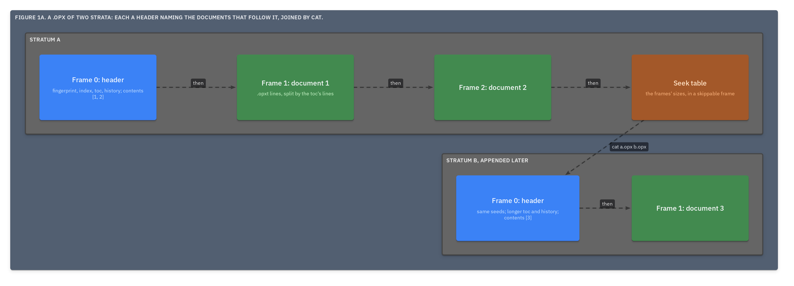
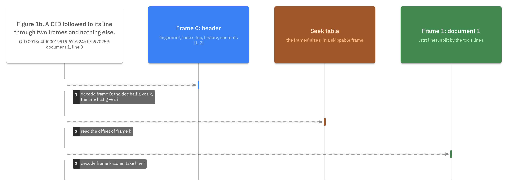

# ADR.15: `.strata` is a corpus at rest, one or more strata of zstd frames, each a header naming the documents that follow it

- Status: approved
- Date: 2026-09-22
- Merge request: https://gitlab.creature-workshop.com/ksoft/strata/-/merge_requests/18
- Argued from: https://linear.app/grand-cluster-city/issue/OPS-1234
- Implementation: not started

## Context

A corpus at rest wants one file that one loop walks and one document can be
pulled from without reading the rest. A computation graph wants more: to
extract documents keeping their ids, to shard a corpus, and to join the
shards back.

zstd's format, RFC 8878, is a sequence of **frames**. Each decodes alone,
frames concatenate into one valid stream, and a **skippable frame** carries
bytes every decoder ignores, where zstd's seekable layout keeps a table of
frame sizes.

The word for the unit is geology's. Strata are laid down in order and never
reworked, the newest on top, each carrying the record of its own forming,
and the history of a place is read down through them.

## Decision

A `.strata` file is a corpus at rest: one or more **strata**, concatenated.
A document alone is a corpus of one.

```
stratum   frame 0   the corpus's header as .strh text, plus one top-level
                    key, "contents": a rising list of the numbers of the
                    documents that follow; absent, every toc entry follows
          frames    those documents, in that order, as .strt text
          last      a seek table in a skippable frame, optional
```





- Every stratum of a file MUST carry the same seeds; a reader MUST refuse
  the file otherwise.
- Each stratum's index, toc and history MUST be a prefix of the longest
  stratum's, which the reader takes as the corpus's.
- A stratum's documents are split by its own toc's `lines`
  ([ADR.10@strata](../000010-the-toc/adr.md)), and a reader MUST refuse a
  stratum whose frame count differs from its contents.
- A number that appears in two strata: the copy in the stratum with the
  longer history stands, whatever the file order.
- Every frame MUST carry the content checksum. No frame references a
  dictionary in this grammar. The level is the tool's.
- A reader MUST accept a file without a seek table and read it sequentially.

## Consequences

`cat a.strata b.strata > c.strata` joins two files of one corpus, and no id or
history entry changes, since a stratum is a layout of documents the history
already records: the strata are the rock, and the history is the log. A stratum whose contents is `[k]` is an extraction that
moves nothing. A run that appends a stratum writes its history entry in that
stratum's header ([ADR.18@strata](../000018-the-history/adr.md)), so the data
and its provenance land in one write.

Two files of different corpora concatenated are refused at the second
header. Merging them is the tool's work: a new corpus, numbered afresh,
whose first history entry names both.

No rule here binds a writer. Every one is checked by a reader from the file
itself: seeds, prefixes, frame counts, line counts, digests, checksums. A
tool that knows none of the rules, `cat` among them, cannot make a file that
reads as valid but is not, only one that is refused, naming where.

A GID reaches its datum by decoding two frames: frame 0 and document k's.

A shared dictionary is an append.
