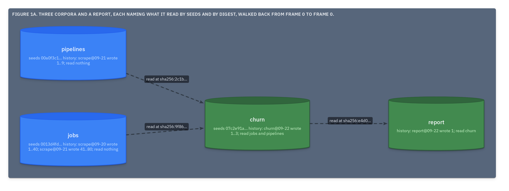

# ADR.18: A corpus's header keeps its history, one entry per run that wrote it, naming the corpora the run read

- Status: approved
- Date: 2026-09-22
- Merge request: https://gitlab.creature-workshop.com/ksoft/strata/-/merge_requests/21
- Argued from: https://linear.app/grand-cluster-city/issue/OPS-1186
- Implementation: not started

## Context

A profiler's computation graph has corpora at every node: scrapers write
them, transforms read some and write others. What a dataset came from, and
which version of it, has to be answerable without a second system keeping
notes, and without opening a document.

A corpus is named by its seeds ([ADR.11@strata](../000011-lids-from-number-and-place/adr.md)),
and its content at a moment by its digest
([ADR.17@strata](../000017-the-digest/adr.md)). Those two are enough to point
at exactly one input as it was read. The header is the one place every
stratum of a corpus carries ([ADR.15@strata](../000015-the-pack/adr.md)).

## Decision

The header holds a fourth part after the toc, the **history**: a list with
one entry per run that wrote into the corpus.

```
0."history":list
1.0:map
2."run":str="motif/churn@2026-09-22T06:10:04Z"
2."at":time-rfc3339-utc=2026-09-22T06:10:04Z
2."wrote":list
3.0:int=7
2."read":list
3.0:map
4."corpus":str="0013d4fd00019919"
4."digest":str="sha256:9f86d081884c7d659a2feaa0c55ad015a3bf4f1b2b0b822cd15d6c15b0f00a08"
```

- `run` names the run in the writer's own words, and `at` is when it ran.
- `wrote` lists the numbers of the documents the run created or appended to.
- `read` lists the corpora the run read: each by its seeds as sixteen hex
  characters, and by the digest of its header as it stood when read.
- The history is append-only. A run that creates or appends to a document
  MUST append one entry, and nothing else appends one: copying or joining
  strata is not a run. No entry is changed or removed.
- Extracting or sharding a corpus writes no entry, since its identity is
  unchanged. A run that makes a new corpus from others, by merging or
  transforming, writes that corpus's first entry.



## Consequences

The whole graph reads from headers. A tool decodes frame 0 of a corpus,
follows each `read` to that corpus's frame 0, and so on back to the
scrapers, opening no document. Where a corpus lives is the tool's lookup;
the format names it and nothing more.

A boundary is never silent. Identity survives extraction and joining, which
record nothing because nothing changed, and does not survive a merge or a
transform, which record everything.

An input is pinned by content, not by name. If an ancestor is rewritten after
the fact, its digest no longer matches the entry, and the mismatch says
exactly where the record and the world parted.

Per-value lineage, an aggregate naming the rows it summed, stays data: a
value holds GIDs. The header carries the run, not the rows.

A corpus written daily for years carries thousands of entries. They are a
few lines each, and they are the point.
