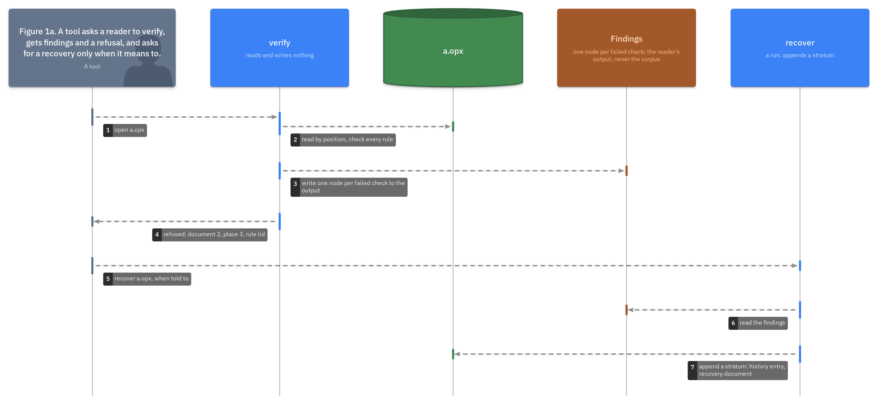

# ADR.25: A reader verifies by default and refuses, a finding is one node from a closed vocabulary, and recovery is a run of its own

- Status: approved
- Date: 2026-09-22
- Merge request: https://gitlab.creature-workshop.com/ksoft/strata/-/merge_requests/28
- Argued from: https://linear.app/grand-cluster-city/issue/OPS-1249
- Implementation: not started

## Context

Every rule of the grammar and the pack is checked by a reader from the file
itself: seeds, prefixes, frame counts, line counts, digests, checksums,
depth and place ([ADR.15@strata](../000015-the-pack/adr.md),
[ADR.10@strata](../000010-the-toc/adr.md),
[ADR.17@strata](../000017-the-digest/adr.md),
[ADR.21@strata](../000021-depth/adr.md),
[ADR.11@strata](../000011-lids-from-number-and-place/adr.md)). A tool that
knows none of them, `cat` among them, cannot make a file that reads as
valid but is not, only one that is refused.

A refusal is a dead end. Nothing says what the reader found past the first
failure, in what form, or what a tool may do about it. Two implementations
must refuse the same file at the same places, and a repair nobody asked for
would turn a foreign edit into a run nobody stood behind. `fsck` reports on
its own and repairs when told.

## Decision

A reader has two operations, **verify** and **recover**, and runs verify
unless told otherwise.



- Verify reads and writes nothing. It checks every rule and produces one
  **finding** per failed check, then refuses a file with any finding,
  naming each. Packed, it reads by position and stops where position is
  lost; unpacked, it checks every document the toc names.
- A finding is one node, and a reader writes its findings as a document to
  its output, never into the corpus it verified:

  ```
  1.0:map
  2."layer":str="grammar"            grammar | pack | history
  2."where":map
  3."number":int=2                   then place, or path, or byte offset
  3."place":int=3
  2."rule":str="lid"                 seeds | prefix | frames | lines | digest
                                     | checksum | depth | lid | absent | read
  2."expected":str="67e924b17b970259"
  2."found":str="67e924b1a03c5f18"
  ```

- The list of rules is closed. Each names the feature whose check it is
  ([ADR.14@strata](../000014-the-version/adr.md)), and a later grammar adds a
  rule by appending.
- Two readers MUST produce the same findings for the same file, in the same
  order, node for node.
- A number the history lists as lost raises no finding
  ([ADR.26@strata](../000026-recovery/adr.md)).
- Recover is a run of its own, and ADR.26 defines it. A reader MUST NOT
  recover unless told to, and a tool that reads for computation refuses.

## Consequences

A refusal names every place, not the first. A finding is data: stored,
diffed, compared across implementations, and handed to a recovery as its
input.

Verify finds every finding it can reach without guessing: all of them in a
directory, and in a packed file every one up to where position is lost.
Scanning for a frame past a cut is a guess two readers could make
differently, so it belongs to recovery, whose output is a run anyone can
inspect.

A closed list makes verify a table. The awk fallback carries one pattern
per rule, and the two implementations are compared on their findings, not
on their messages.

Nothing is repaired in passing. A corpus a computation reads is the corpus
its history describes, or it is refused; changing it is a run with a name
and a time, chosen by someone.
