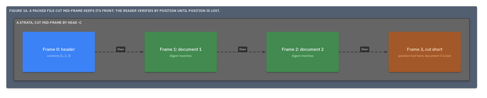
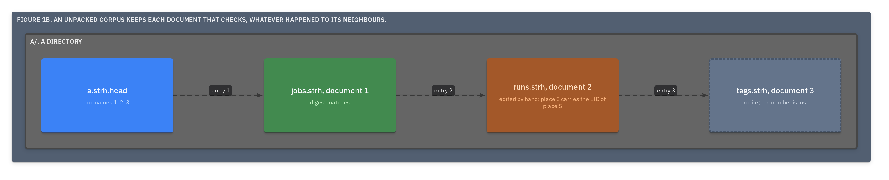
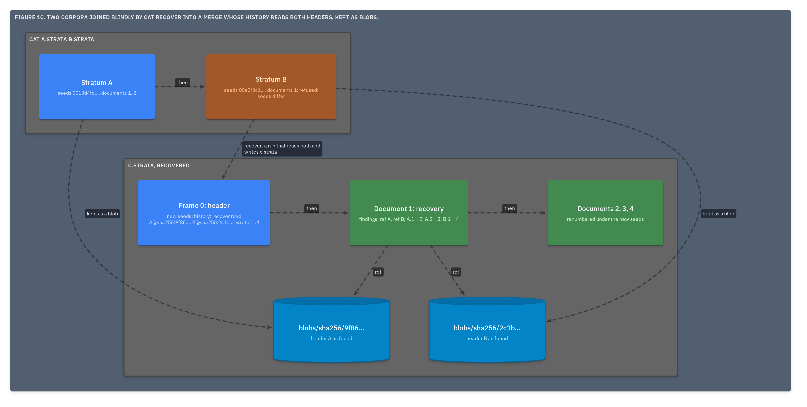

# ADR.26: Recovery is a run that reads what verifies, keeps what does not as blobs, appends what it rebuilds, and lists what is lost

- Status: approved
- Date: 2026-09-22
- Merge request: https://gitlab.creature-workshop.com/ksoft/opx/-/merge_requests/29
- Argued from: https://linear.app/grand-cluster-city/issue/OPS-1250
- Implementation: not started

## Context

Files are cut, edited and joined by tools that know no grammar: `cat`,
`head`, `sed -i`, an editor, a crash mid-write. Verify says where a file
stops being a corpus ([ADR.25@opx](../000025-verify-and-recover/adr.md))
and nothing more, and the history has no entry for what was not a run
([ADR.18@opx](../000018-the-history/adr.md)).

What survives is provable. A LID is a function of number and place
([ADR.11@opx](../000011-lids-from-number-and-place/adr.md)), so a cut
inside a document is located to the line; a digest names a document's
content ([ADR.17@opx](../000017-the-digest/adr.md)); a number is never
given twice ([ADR.10@opx](../000010-the-toc/adr.md)); and a blob keeps
bytes by their digest ([ADR.24@opx](../000024-the-ref/adr.md)).

## Decision

Recovery is a run. It appends one history entry and one **recovery
document**, writes a new stratum or a new file, and modifies no input byte.





- The reader partitions the file. Packed: the front up to the first finding,
  then any frame found by scanning whose digest a toc entry names. Unpacked:
  each document by itself.
- The history entry gains **`lost`**: the numbers the toc names with no
  verified bytes. A number listed as lost raises no finding afterward, and
  its toc entry stands.

  ```
  2."run":str="strata/recover@2026-09-22T19:02:11Z"
  2."wrote":list        the recovery document, then every number appended
  2."read":list         every verified header, by seeds and digest
  2."lost":list
  3.0:int=4
  ```

- A header with other seeds is kept as a blob, and the recovery document
  names it by a `ref`.
- Foreign bytes that parse as documents are appended as new numbers under
  the corpus's seeds, their LIDs from number and place. A document whose
  bytes changed under its own entry is appended as a new number that
  supersedes it, and the old number is lost.
- Identity is kept when every verified header shares one pair of seeds.
  Otherwise the result is a new corpus, and its first entry reads them all.
- The recovery document holds the findings as verify wrote them, the refs,
  and a map from each old number to the number that supersedes it.



## Consequences

Nothing is accepted in silence. A foreign act becomes an entry that says it
was not a run, what it cost, and when: after the header the entry reads was
written, and before the entry's `at`. The bracket is all the record claims
about time, as a gap in strata is dated by the layers below and above it.

Two corpora joined by `cat` recover into a merge, and the merge's history
reaches both inputs' histories through their headers' digests, which the
blobs make resolvable.

A cut is located to the line and a lost document to its number. What a
shape of loss usually means, and which tool leaves it, is a catalogue for
research, not a rule here.

Given the same file, seeds and time, two implementations write the same
corpus, so recovery is under the byte-for-byte contract as verify is.
