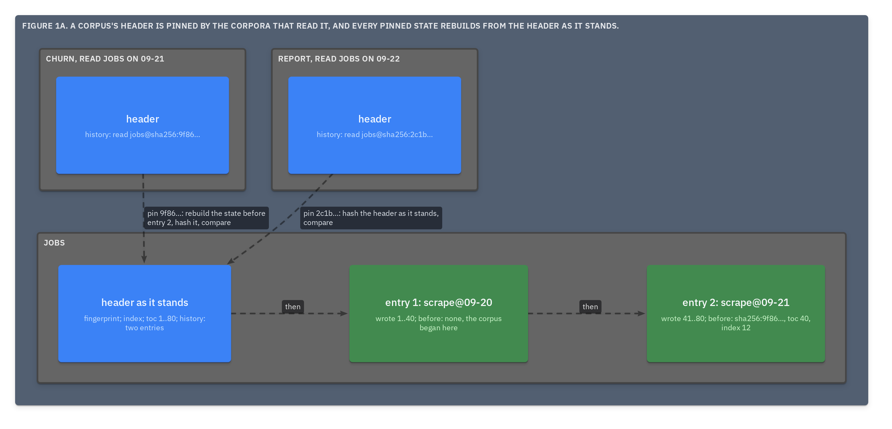

# ADR.27: The header is the root, so a file proves its integrity, its readers prove its authenticity, and a lost header is rebuilt from both

- Status: approved
- Date: 2026-09-22
- Merge request: https://gitlab.creature-workshop.com/ksoft/strata/-/merge_requests/30
- Argued from: https://linear.app/grand-cluster-city/issue/OPS-1251
- Implementation: not started

## Context

The toc's digests cover every document and the header's digest covers the
toc ([ADR.17@strata](../000017-the-digest/adr.md)), so a file proves that its
documents are the ones its header names. Nothing covers the header from
inside: a value cannot hold its own digest, and a history entry's `run` is
text ([ADR.18@strata](../000018-the-history/adr.md)). A header edited to match
an edited document passes every check the file can make.

## Decision

- A file proves its **integrity**, never its **authenticity**. A reader
  stores a history entry as a claim and MUST NOT present it as proof of who
  ran.
- Authenticity comes from outside: a `read` in another corpus is a **pin**,
  the header's digest as it stood.
- A history entry gains **`before`**: the digest of the header the run
  found, with its fingerprint and its index and toc counts. Every part only
  grows, so a reader rebuilds that state from the header it holds, hashes
  it, and MUST refuse a corpus in which a pinned digest rebuilds to other
  bytes. A run MAY also keep the header it read as a blob
  ([ADR.24@strata](../000024-the-ref/adr.md)).
- Signing an entry is a later feature, and appends.
- A tool MAY **shift** a file into one stratum: the latest header, then
  every document. A shift is a layout, not a run
  ([ADR.15@strata](../000015-the-pack/adr.md)). It drops no state a reader
  cannot rebuild, and it moves a frame out of the file only into the
  corpus's store ([ADR.24@strata](../000024-the-ref/adr.md)); with no store,
  it drops nothing.
- A lost header is recovered ([ADR.26@strata](../000026-recovery/adr.md)):
  - Packed, every stratum carries the header as it stood, so the latest
    surviving stratum's holds all it held, and the frames after it are
    foreign bytes.
  - Unpacked, the seeds are in every `read` that names the corpus; failing
    those, the line seed is exact from any line, and the document seed is
    fixed up to which number the first document had
    ([ADR.9@strata](../000009-ecuyer1988-doc-line/adr.md)). The index rebuilds
    from `.strh` keys, never from `.strt` codes. The toc rebuilds from paths,
    line counts and digests. The history does not come back: the recovered
    corpus's entry reads nothing, and its recovery document says so.

## Consequences

Tampering is caught by whoever read the corpus, and caught exactly: the
state that no longer rebuilds to its digest says which entry changed. The
history is a chain, each entry naming the state before it, so an entry
cannot be altered without every later `before` failing.

The cost is a few lines per run.

A shift keeps the file at one header, and every state it ever had still
rebuilds from that one. The unpacked form keeps one header, with the lines
carrying enough to rebuild all but the history.
