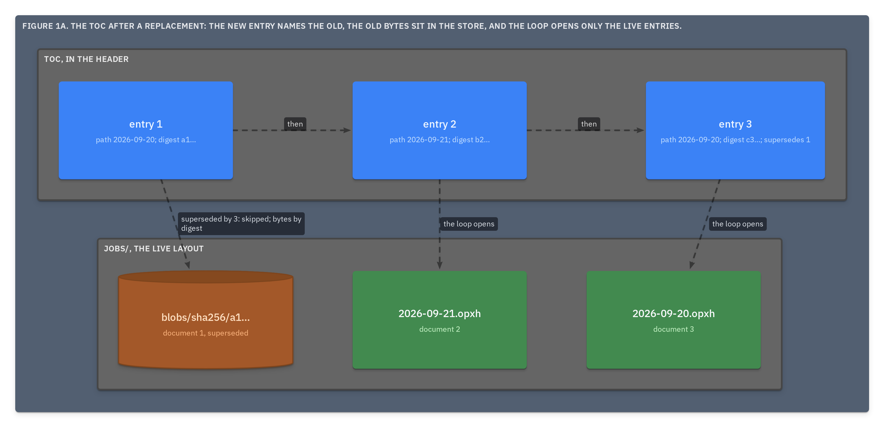

# ADR.28: A replacement document names the one it supersedes in its own toc entry, every entry is written once, and a reader's loop sees only what is current

- Status: approved
- Date: 2026-09-22
- Merge request: https://gitlab.creature-workshop.com/ksoft/opx/-/merge_requests/31
- Argued from: https://linear.app/grand-cluster-city/issue/OPS-1256
- Implementation: not started

## Context

The records so far say a replacement document "supersedes" the old one and
mark nothing, so a loop over the toc hands back the stale one beside the
new. [ADR.10@opx](../000010-the-toc/adr.md) let an entry change after it
was written: `lines` with every append, `path` at will. A frame is written
once ([ADR.15@opx](../000015-the-pack/adr.md)), and `before`
([ADR.27@opx](../000027-the-root/adr.md)) rebuilds a past header from entry
counts. Both need an entry that never changes.

## Decision

- A toc entry is written once and never changed. ADR.10's "`lines` changes
  with every append" and "`path` MAY change" are withdrawn; the rest of
  ADR.10 stands.
- Growing or rewriting a document is a new number. Its entry carries
  **`supersedes`**, the number it replaces, and takes that entry's path.
  Two entries share a path only when one supersedes the other.

  ```
  2."path":str="jobs/2026-09-20"
  2."lines":int=41
  2."digest":str="sha256:c3a1…"
  2."supersedes":int=1
  ```

- The **live** documents are the entries no entry supersedes. A reader
  iterating documents MUST make one pass over the toc to collect the
  superseded numbers, then open each live entry's path.
- A superseded entry keeps its number, `lines` and `digest`. Its bytes
  leave the live layout for the store, named by that digest
  ([ADR.24@opx](../000024-the-ref/adr.md)), in the same writeback that
  writes the replacement. Packed, that writeback is a shift
  ([ADR.27@opx](../000027-the-root/adr.md)): after any run the file holds
  the live documents in toc order and nothing else. A run with nowhere to
  put the bytes MUST refuse rather than leave them or drop them. A
  superseded entry with no bytes behind it raises no finding
  ([ADR.25@opx](../000025-verify-and-recover/adr.md)).
- The history is unchanged: the run's entry says `wrote [3]`.

```
day 1   jobs/2026-09-20.opxh   document 1     toc  1 path 2026-09-20 digest a1…
        jobs/2026-09-21.opxh   document 2          2 path 2026-09-21 digest b2…

day 2   jobs/2026-09-20.opxh   document 3     toc  1 path 2026-09-20 digest a1…
        jobs/2026-09-21.opxh   document 2          2 path 2026-09-21 digest b2…
        blobs/sha256/a1…       document 1's        3 path 2026-09-20 digest c3…
                               old bytes             supersedes 1
                                              the loop sees 3 and 2
```



## Consequences

One loop, the same in both layouts, and nothing stale comes out of it.
`zstd -dc` on a packed corpus, and `grep` after it, walk exactly the live
documents, so the awk fallback never meets a superseded line.

A superseding run on a packed corpus rewrites the file, a byte copy of the
live frames with no decompression; an appending run still appends. A
document rewritten daily costs a rewrite daily, and the store holds each
old version once.

A number is never reused, so a GID into a superseded document still
resolves: to its entry, to its digest, and to its bytes in the store.

Every entry being immutable, each stratum's toc is a byte prefix of the
next, and a past header rebuilds exactly.

A corpus only grows. Shedding what it names is a change of identity, and
that is a repack ([ADR.29@opx](../000029-repack/adr.md)).
