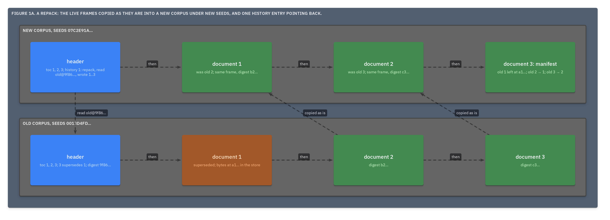

# ADR.29: A repack is a new corpus of the live documents, numbered afresh, whose first history entry reads the old one

- Status: approved
- Date: 2026-09-22
- Merge request: https://gitlab.creature-workshop.com/ksoft/opx/-/merge_requests/32
- Argued from: https://linear.app/grand-cluster-city/issue/OPS-1257
- Implementation: not started

## Context

A corpus only grows ([ADR.28@opx](../000028-supersedes/adr.md)). A shift
([ADR.27@opx](../000027-the-root/adr.md)) folds its file but keeps
everything the corpus names, because a corpus is its seeds and its header,
and a header that names bytes it cannot produce is a broken promise. A
corpus that rewrites documents daily therefore carries every old version
in its store and every dead entry in its toc, for as long as it is itself.

Shedding them means the corpus no longer names them, which is a change of
identity. [ADR.18@opx](../000018-the-history/adr.md) already says that a
new corpus made from others writes that corpus's first history entry.

## Decision

- A **repack** is a run that reads a corpus at its digest and writes a new
  corpus: the live documents, in toc order, numbered from 1, under new
  seeds.
- The index is carried over unchanged, so every live document's terse text,
  and so its digest and its frame, is copied as it is
  ([ADR.16@opx](../000016-two-document-forms-one-corpus-form/adr.md)).
  Only the LIDs change, and the terse form does not write them.
- The new corpus's first history entry reads the old corpus by seeds and
  digest and writes every number. No other entry carries over: the old
  history is reached through that `read`.
- The repack MAY write one more document, its **manifest**: each old
  number with the new number it became, or the digest it was left behind
  with.
- The old corpus is kept or discarded whole. A repack never modifies it.

```
old   seeds 0013d4fd…   toc  1 a1…   2 b2…   3 c3… supersedes 1
                        store: a1…
new   seeds 07c2e91a…   toc  1 b2…   2 c3…   3 manifest
                        history 1: repack@…  wrote [1, 2, 3]
                                   read [0013d4fd…@sha256:9f86…]
                        manifest:  old 1 left at a1…; old 2 → 1; old 3 → 2
```



## Consequences

Identity is the line between the two operations, and the only reason to
choose. A shift keeps every GID and sheds nothing; a repack sheds
everything not live and keeps no GID. A consumer holding a GID into the
old corpus resolves it there, or through the manifest.

The repacked corpus starts clean: one stratum, one header, no superseded
entries, an empty store, and a size equal to its live documents.

Provenance is one hop. The new header's first entry names the old corpus
at the digest it was read at, and a reader rebuilds that state from the
old header and checks it ([ADR.27@opx](../000027-the-root/adr.md)).

The cost is the copy of every live frame, byte for byte, and a new header.
No document is decompressed.
