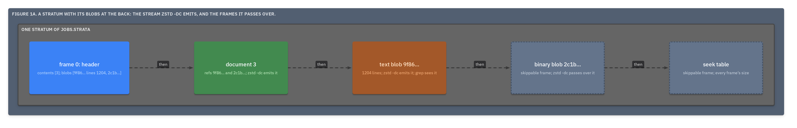

# ADR.30: A stratum carries the blobs its run made after its documents, frame 0 lists them, and a lone `.strata` is its own store

- Status: approved
- Date: 2026-09-22
- Merge request: https://gitlab.creature-workshop.com/ksoft/opx/-/merge_requests/33
- Argued from: https://linear.app/grand-cluster-city/issue/OPS-1259
- Implementation: not started

## Context

[ADR.24@opx](../000024-the-ref/adr.md) made a `ref` name a blob in a
store and left how a pack carries blobs for later: a pack named the blobs
its store held and carried none. Two records now need it. `zstd -dc | grep`
reaches a `ref` line and not the bytes it names, and
[ADR.28@opx](../000028-supersedes/adr.md) has a run refuse when it has
nowhere to put a superseded document's bytes, which for a lone file is
always.

At the end of the file, every append would copy the largest bytes in the
file. A document that referred forward would make a reader look ahead. And
the awk fallback reads `zstd -dc` as lines, so bytes that are not lines
must never reach it.

## Decision

- A stratum is frame 0, its documents, then one frame per blob its run
  made or moved to the store, then the seek table. Blob frames come in the
  order their digests are first met. A document refers only backward: to a
  blob in its own stratum or an earlier one.
- Frame 0's `contents` gains **`blobs`**: each blob that follows, in order,
  with its digest and, for a text blob, its line count.

  ```
  1."blobs":list
  2.0:map
  3."digest":str="sha256:9f86d081884c7d659a2feaa0c55ad015a3bf4f1b2b0b822cd15d6c15b0f00a08"
  3."lines":int=1204
  ```

- A **text** blob, one that is text under
  [ADR.19@opx](../000019-text/adr.md), is a zstd frame like a document, and
  `zstd -dc` emits it. A **binary** blob is a skippable frame whose payload
  is its bytes as one zstd frame, and `zstd -dc` passes over it. A reader
  that verifies MUST refuse a blob frame whose bytes do not hash to the
  digest that names it.
- A `ref` resolves in the file first, then in a store beside it. A reader
  MUST report a `ref` it resolves in neither as `absent`
  ([ADR.25@opx](../000025-verify-and-recover/adr.md)).
- A lone `.strata` is its own store. A superseded document's bytes become a
  blob frame in the stratum whose run superseded it, so ADR.28's refusal
  does not apply to a packed corpus.
- A shift copies blob frames as it copies document frames and puts every
  blob after every document. A repack carries only the blobs its live
  documents name.

```
appended   [h1 d1 d2 t(d1) seek] [h2 d3 t(d3) B(d3) seek]   references per chapter
shifted    [h  d1 d2 d3 t(d1) t(d3) B(d3) seek]              references at the back
                                                   t: text blob   B: binary blob
```



## Consequences

`zstd -dc | grep` sees a text blob's content after the lines that name it,
and never a binary blob. The awk fallback stays whole: it reads
the header, the documents and the text blobs as lines, skipping each text
blob by the count frame 0 gives it, and the binary blobs never reach it.

Appending stays an append, and frame 0 names every frame of its stratum.

A superseded document costs one blob frame, copied as bytes by a shift or
a repack.

A binary blob is compressed once inside its skippable frame, and only the
tool's reader opens it.
